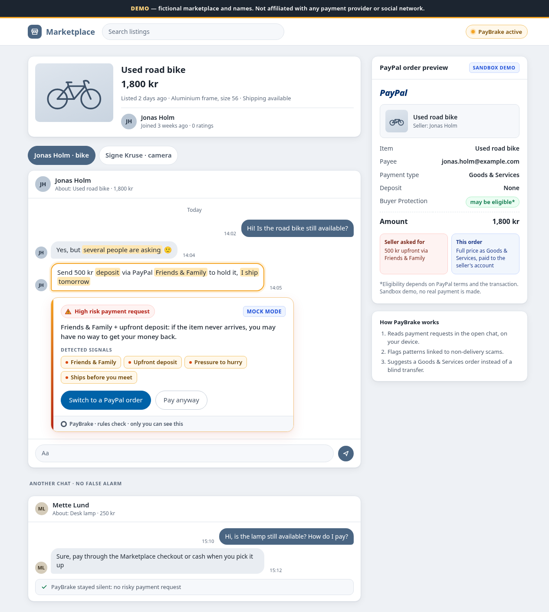
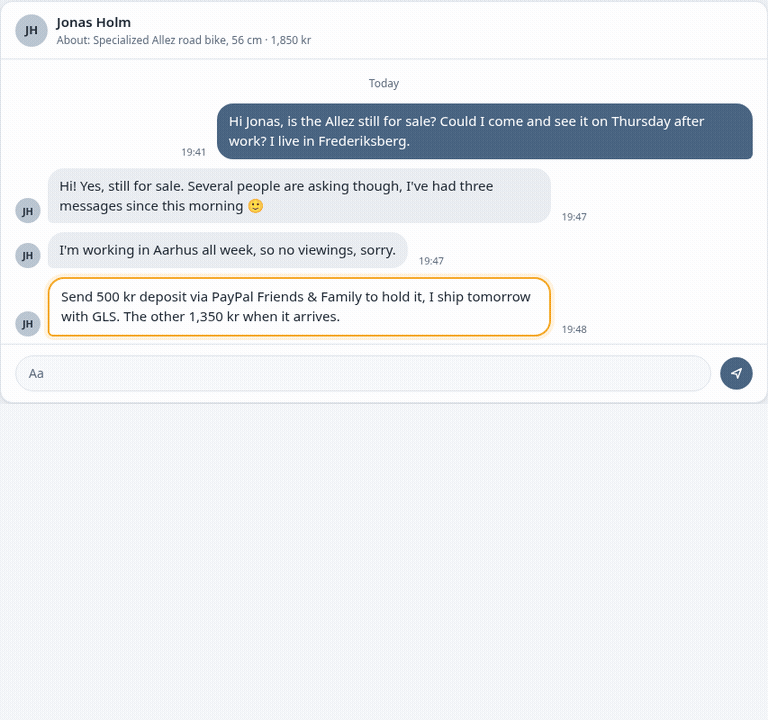

# PayBrake

**Brakes before you pay.** PayBrake is a Chrome extension that catches scam payment requests in marketplace chats and offers a safer **PayPal** checkout instead.

When a "seller" asks for a blind transfer, a PayPal Friends & Family payment, a gift card or a code, PayBrake flags it with on-device rules plus an **AI** check, quotes the risky line, and offers a **PayPal** Goods & Services order (PayPal Orders v2, **sandbox**) for the item and price in the chat.

**Try it in about 2 minutes, nothing to run locally:** https://paybrake-demo.spbabinov.workers.dev/ ([steps below](#try-it-hosted-nothing-to-run-locally))

- **PayPal (sandbox):** one click turns the risky ask into a PayPal Orders v2 order for the item and price in the chat: create, approve, capture. Live PayPal is refused in code.
- **AI:** a server-side AI check (Typesafe `jev-1.14.0`) confirms or lowers the rules verdict. It can never raise it, and if the AI is down, the rules still work.
- **Explains itself:** the card names the risky payment request with a quote from the message.

Built with: **PayPal** Orders v2 API (sandbox, plus a no-credentials mock), the **PayPal Agent Toolkit** tool names (`create_order`, `get_order`, `pay_order`), an **AI** scam check on Typesafe models (`jev-1.14.0`, server-side key), Chrome Manifest V3, Node 20, Cloudflare Workers.

Fictional names only. Not affiliated with PayPal or any marketplace. No real money moves in this build.

## Why

Marketplace scams usually end the same way: the "seller" pushes the buyer off the protected path, to PayPal Friends & Family, a bank transfer, a gift card, crypto, or an upfront deposit for an item the buyer has not seen. PayBrake puts a brake on that moment. It reads the chat, names the risky payment request with a quote from the message, and offers a PayPal Goods & Services order for the listed item instead.

## How PayPal and AI are used

- **PayPal (sandbox only).** "Switch to a PayPal order" creates a PayPal Orders v2 order (`intent: CAPTURE`) for the item and price in the chat, sends the buyer to PayPal's sandbox approval page, and captures after approval. Code: `backend/src/paypal-rest.js`, used by both the local backend and the hosted Worker. Without sandbox keys the same flow runs on a mock (`MOCK-` order ids), so the demo never breaks. Live PayPal is refused in code.
- **AI.** On-device rules find the payment request; an AI check (`/api/classify`, Typesafe model `jev-1.14.0`, key server-side only) confirms or lowers the risk level and can add a card when the rules are silent on a clear scam. It can never raise the rules level, and a quote not present in the message is ignored. If the AI is down or rate-limited, the extension falls back to rules only.

## Try it (hosted, nothing to run locally)

**Start here: https://paybrake-demo.spbabinov.workers.dev/** (demo link, not indexed by search engines)

1. Download **[paybrake-extension.zip](https://paybrake-demo.spbabinov.workers.dev/paybrake-extension.zip)** from that page and unzip it.
2. In Chrome (or Edge / Brave) open `chrome://extensions`, switch on **Developer mode**, click **Load unpacked**, and pick the `paybrake-extension` folder (the one with `manifest.json`). A **Welcome to PayBrake** tab opens.
3. Click **Try the demo store** (or open https://paybrake-demo.spbabinov.workers.dev/demo/marketplace.html?live=1). In the bike chat a **High risk** card appears, tagged **AI checked** once the AI verdict is back.
4. **Switch to a PayPal order** → **Open approval** → **Approve (mock)** → back in the chat **I approved it, capture**.

About 2 minutes. When the hosted server runs on PayPal sandbox (`/health` shows `"paypal": "rest"`), **Open approval** goes to PayPal's sandbox approval page instead of the **Approve (mock)** button. Step-by-step guide: [TESTING.md](TESTING.md).

The hosted server is one Cloudflare Worker (free plan): the demo store pages, the PayPal order backend (PayPal sandbox when the `PAYPAL_CLIENT_ID` and `PAYPAL_CLIENT_SECRET` Worker secrets are set, otherwise mock orders kept 24 hours; `/health` shows `"paypal": "rest"` or `"mock"`; optional `PAYPAL_PAYEE_EMAIL` = your sandbox Business account), and `/api/classify`, the AI check. The Typesafe key lives only in the Worker as a secret; the extension never sees it.

### Hosted demo limits

The AI check spends a real API key, so `/api/classify` on the hosted Worker is capped (see `hosted/src/index.js`):

| Limit | Value | When hit |
|---|---|---|
| Input length | 2000 characters (the extension sends the latest 1900) | 413 `text_too_long`, no model call |
| Per IP, per minute | 20 (strict, Durable Object) and 30 (Cloudflare rate-limit binding) | 429 `rate_limited`, `Retry-After: 60` |
| Per IP, per day | 150 | 429 `busy` |
| All visitors, per day (UTC) | 2000 | 429 `busy` |
| Request body | 16 KB | 413 |
| Kill switch | `AI_KILL_SWITCH=1` (Worker secret or var) | AI off at once: `/health` says `"llm": "off"`, `/api/classify` 503 `llm_off` |

On any non-200 the extension falls back to its on-device rules, so the demo keeps working with the AI off. `GET /health` shows the active limits and the kill switch state. Optional vars `AI_PER_IP_PER_MINUTE`, `AI_PER_IP_PER_DAY`, `AI_PER_DAY` change the caps, up to hard maxima of 60, 1000 and 20000.

Kill switch: `cd hosted && npx wrangler secret put AI_KILL_SWITCH` (enter `1`). Turn it back on with `npx wrangler secret delete AI_KILL_SWITCH`. No redeploy needed.

Deploy: `npm run hosted:deploy` (builds the extension zip and the pages into `hosted/public/`, then `wrangler deploy`; wrangler 4 itself needs Node 22+). Set the key once with `npx wrangler secret put TYPESAFE_API_KEY`. Never commit it.

## Architecture

```
 Chrome extension (MV3)                       Cloudflare Worker (hosted demo) / Node backend (local)
 ┌──────────────────────────────┐            ┌─────────────────────────────────────────────┐
 │ content.js: reads the chat,  │  /api/     │ /api/classify  -> AI check (Typesafe)       │
 │ rules (atoms.js), redacts,   │ ─classify─>│   capped per IP and per day, kill switch    │
 │ draws the PayBrake card      │            │                                             │
 │ background.js: cache, log    │ ─protect─> │ /api/protect, /api/orders/:id/capture       │
 └──────────────────────────────┘            │   PayPal Orders v2 sandbox (keys set)       │
                                             │   or mock orders in a Durable Object        │
                                             └─────────────────────────────────────────────┘
```

## Run it locally (5 minutes)

From a clean clone, Node 20:

```sh
npm install
cp backend/.env.example backend/.env
npm run dev:backend
```

In a second terminal:

```sh
npm run serve:demo
```

Then:

1. Open `chrome://extensions`.
2. Turn on Developer mode.
3. Load unpacked and choose the `extension/` folder (the one with `manifest.json`, not the repo root).
   The extension talks to the hosted mock server by default. For this local setup open its options, click **Use localhost:8787**, and save.
4. Open `http://localhost:8080/demo/marketplace.html?live=1`.

The static card is hidden. The extension draws its own card in the bike thread. **Switch to a PayPal order** creates a `MOCK-` sandbox order with no PayPal credentials. **Open approval** goes to a mock page. **Approve (mock)**, return to the chat, then **I approved it, capture**.

`Signe Kruse · camera` is a second risky thread for **Pay anyway**. `demo/safe-chats.html` should stay silent.



That image is the unpacked extension on the local demo, from `npm run e2e`. The bike card says **High risk payment request** and lists four signals: Friends & Family, Upfront deposit, Pressure to hurry, and Ships before you meet. The buttons are **Switch to a PayPal order** and **Pay anyway**. With no model configured, the card says the AI check is off on the mock server. The lamp thread on the same page stays silent. On a phone the details start collapsed and those two buttons stack (`shots/ext-live-390.png`).



The clip is that same thread: no card, then the card, then **Open approval** after the mock order is created. The order id changes on every run.

These steps are the local path. The hosted path above is the same interaction without Node. Narration for a recording is in [the video script](docs/DEMO-VIDEO-SCRIPT.md). Open items before a public submission are in [submission gaps](docs/SUBMISSION-GAPS.md).

Options (right-click the toolbar icon, or open the extension's options page): backend URL (default: the hosted mock server `https://paybrake-demo.spbabinov.workers.dev`; one click switches to `http://localhost:8787`), rules-only vs an AI check, a debug HUD, and the on-device override log (download JSON or clear).

## What the pieces do

```
demo page (data-pb-* threads)
        |
        v
content.js  ----messages---->  background.js
 shadow card                     cache by hash + rules version
 never clicks the site           override ring log (max 200)
        ^                          |
        |                          v
        +-------- JSON --------  server.js   :8787
                                 OrdersPort
                                   mock     (empty client id, or PAYPAL_ADAPTER=mock)
                                   rest     (sandbox Orders v2)
                                   toolkit  (tool names; calls go through rest)
                                 /api/classify
                                   off until a provider is set
                                   openrouter or openai-compatible
```

Detection runs in the extension from regex atoms (English and Danish). The backend creates orders and, when the AI check is on, calls the model. With the AI check left off, a stopped backend still shows the card. Protect then shows one line: the helper could not be reached.

## Mock and sandbox

| | Mock | Sandbox |
|---|---|---|
| When | `PAYPAL_CLIENT_ID` empty, or `PAYPAL_ADAPTER=mock` | client id and secret set, adapter `rest` or empty |
| Order id | `MOCK-<uuid>` | PayPal order id |
| Approval | `demo/checkout-return.html` button | PayPal sandbox page (`payer-action` link, else `approve`) |
| Money | none | sandbox only |

`PAYPAL_ENV` must be `sandbox`. The process refuses to start otherwise, including `live`. `PAYPAL_BASE_URL` must be `https://api-m.sandbox.paypal.com` (the default when the variable is empty) or `https://api.sandbox.paypal.com`. Any other host is refused.

With an empty client id, `PAYPAL_ADAPTER=rest` still selects mock. `/health` then shows `"paypal": "mock"`.

### PayPal Agent Toolkit: what we found (SPEC §5)

Published `@paypal/agent-toolkit` 1.11.0: `create_order` has no payee field, and `currencyCode` is USD only. The package also pulls in `ai`, `openai`, `langchain`, `axios`, and the PayPal server SDK. This repo does not install it.

`backend/src/paypal-toolkit.js` is a stub with the tool names `create_order`, `get_order`, and `pay_order`. Each call runs through the rest adapter, which sends `payee.email_address` and accepts DKK, EUR, and USD. `PAYPAL_ADAPTER=toolkit` needs the same client id and secret as rest. `backend/src/agent.js` fills `create_order` from the validated deal and calls `runTool`. There is no model tool loop.

## Switch from mock to PayPal sandbox

1. Log in at [developer.paypal.com](https://developer.paypal.com) with a PayPal account. Open **Apps & Credentials**, set the toggle to **Sandbox**, and choose **Create App** with type **Merchant**. Copy the Client ID and the Secret. Keep both out of git.

2. Open **Testing Tools → Sandbox Accounts**. Use or create one **Business** account (the seller; its email is the payee) and one **Personal** account (the buyer; this is the login on the approval page).

3. Run `cp backend/.env.example backend/.env`. Set `PAYPAL_CLIENT_ID` and `PAYPAL_CLIENT_SECRET`. Leave `PAYPAL_ENV=sandbox` and `PAYPAL_ADAPTER=rest`. `backend/.env` is gitignored. Never commit it.

4. Run `npm run dev:backend`. Open `http://127.0.0.1:8787/health`. `paypal` is `"rest"`. If the client id is set and the secret is empty, the process exits with `PAYPAL_CLIENT_SECRET is required for the rest adapter`. An empty client id leaves `paypal` as `"mock"`.

5. On the demo page, press **Switch to a PayPal order**. **Open approval** opens the PayPal sandbox page. Log in as the sandbox Personal buyer, approve, and the browser returns to the demo return page (the **Approve (mock)** button stays hidden). Go back to the chat and press **I approved it, capture**.

The payee has to be that Business account's email, or PayPal rejects the order. The bike messages contain no email address, so the extension sends `data-pb-seller-email` from the thread. In `demo/marketplace.html`, on the section `#thread-bike`, change `data-pb-seller-email` from `jonas.holm@example.com` to the sandbox Business email before you click protect. The card field **Seller email for this order** (`#pb-email` in `extension/content.js`) is shown only when that value is missing, so this thread does not show it. For the camera thread, edit the same attribute on `#thread-camera` (currently `signe.kruse@example.com`). An email written in a message wins over the attribute (`extension/lib/extract.js`).

The bike price is DKK. Rest accepts DKK, EUR, and USD.

## Turn on the AI check

Typesafe (what the hosted demo uses): in `backend/.env`, set `LLM_PROVIDER=typesafe` and `TYPESAFE_API_KEY`. OpenRouter: set `LLM_PROVIDER=openrouter` and set `OPENROUTER_API_KEY` to your OpenRouter key. Restart the backend. `/health` shows `"llm": "configured"` and `"llmProvider": "openrouter"`. A key with `LLM_PROVIDER` and `LLM_BASE_URL` both empty selects openrouter the same way. If `LLM_BASE_URL` is set, that empty provider means openai-compatible instead. Any other `LLM_PROVIDER` value stops the process at startup (`Unknown LLM_PROVIDER`). With `LLM_PROVIDER=openrouter`, `LLM_BASE_URL` is used only when it is https on `openrouter.ai`; any other host is ignored, so the key is not sent there. In the extension options, turn on **Ask the backend for an AI check (off uses rules only)** and save. The model can confirm a rules hit or lower it. It cannot raise one. A quote that is not in the message is ignored.

## Checks

Offline:

```sh
npm test
npm run eval
```

`npm test` passes 259 tests. All of them are offline. The script lists `tests/*.mjs` and `backend/test/*.mjs` in Node (`scripts/run-tests.mjs`). It does not need the shell to expand globs, so the same command works on Node 20 and on Windows `cmd`.

Rules eval on the synthetic set in `eval/cases/` (35 chats): precision 1, recall 1, false alarms 0 (tp 18, fp 0, fn 0, tn 17). The run exits 1 if precision is under 0.95, recall is under 0.80, or any safe case fires. Live eval exits 0 with a skip message unless `/health` reports the model configured.

`npm run shots` and `npm run e2e` refreshed `shots/demo-1280.png`, `shots/demo-390.png`, `shots/demo-1280-protect.png`, `shots/live-1280.png`, `shots/live-1280-order.png`, `shots/live-390.png`, `shots/ext-live-1280.png`, `shots/ext-live-390.png`, and `shots/demo.gif` on this branch. `shots/safe-1280.png` was rewritten by the same shots run and matched the file already on main.

TODO (stale assets): `shots/tester/`, `shots/tester-v2/`, `shots/tester-v3/`, `shots/ai-live/`, and `shots/pilot-*.png` were not regenerated here. Do not treat those as current. `npm run e2e:hosted` was not run.

Screenshots: `npm run shots`. Extension smoke: `npm run e2e` (Chromium with the unpacked extension). If the browser cannot load an extension in this environment, that script prints `SKIP` and exits 0.

## Limits

- Atoms are English and Danish only. Wording outside the list stays silent on purpose.
- The model can confirm or lower a hit. It cannot raise one, and a quote that is not in the message is ignored.
- Mock orders live in memory on one Node process. Rest orders live at PayPal. This process keeps the OAuth token in memory.
- One demo adapter (`data-pb-*` on our own pages). No adapters for real marketplaces.
- Buyer Protection copy says **may be eligible**, and points at PayPal's terms. The UI does not claim a payment is certain or covered.

## Team

- Dmitrii Babinov ([@lamapony](https://github.com/lamapony)): hosted demo, extension, README
- Christopher Wang ([@christopherwang0129SE](https://github.com/christopherwang0129SE)): PayPal backend
- David ([@David-Dashboard](https://github.com/David-Dashboard)): AI model

Built for the PayPal AI Hackathon on Devpost.

## License

MIT © 2026 Dmitrii Babinov and Christopher Wang
